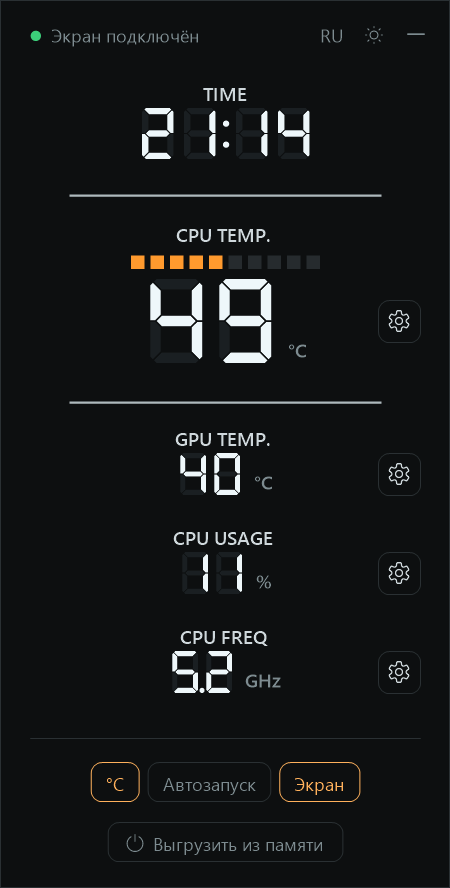

# Jonsbo D34 Mon

An **experimental**, lightweight, standalone alternative to JONSBO's *PC Monitor All* for the **JONSBO D34** case screen:
time, CPU temperature (with the bar), GPU temperature, CPU load and CPU clock.

*Кратко на русском: [внизу страницы](#по-русски).*

> ⚠️ This is one enthusiast's experiment, not a product. Tested on one PC.
> Read [Risks and limitations](#risks-and-limitations) before installing.
> Not affiliated with JONSBO.

## Before → after

The original *PC Monitor All 1.0* and Jonsbo D34 Mon 1.1 on the same PC, running in the background (minimized to the tray),
60-second measurement. Ryzen 7 9800X3D, RTX 5070 Ti, Windows 11.

| | PC Monitor All 1.0 | Jonsbo D34 Mon 1.1 |
|---|---|---|
| CPU load | **15–19 %** of one core, constantly | **0.55 %** of one core |
| Private memory | ~75 MB | **~16 MB** |
| Handles | **leak**: 44,000 after 2.5 h, +5 per second | stable, ~410 |
| Threads | 23 | 12 |
| Sensor polling | all 22 HWiNFO devices every second (including memory sticks at 30 ms each) | only the 4 values shown |
| Screen updates | 5/s, normal priority | 4/s from a high-priority thread: the screen doesn't blank even at 100 % CPU load (max gap 265 ms) |
| Dependencies | closed HWiNFO SDK licensed to JONSBO | open: LibreHardwareMonitor + PawnIO driver |
| Window | cluttered, 11 dropdowns | replica of the case screen; ⚙ next to a value picks the sensor |
| Theme / language | none / Chinese, English | light and dark / English, Russian |

What was wrong with the original (found by reading its decompiled code):

- 20 times a second it re-reads the list of all Windows processes just to check that a second copy isn't running. That's where the CPU load and the handle leak come from;
- every second it walks 512 indexes × 8 types for every HWiNFO sensor;
- CPU voltage is sent to the screen incorrectly (always "1.00 V");
- autostart can't be turned off: the checkbox removes the registry entry, but the shortcut in the Startup folder stays;
- the "Show on screen" option does nothing, the language isn't saved, and on exit the process kills itself.

## Install

Download from [Releases](../../releases):

| File | What it is |
|---|---|
| `Jonsbo D34 Mon 1.1.1 (en).msi` / `(ru).msi` | installer: Program Files, shortcuts, uninstall from *Apps* |
| `Jonsbo D34 Mon 1.1.1 portable.zip` | portable build: unzip and run, settings are stored next to the exe |
| `SHA256SUMS.txt` | file checksums |

- .NET is built in, nothing else to install.
- The installer installs the [PawnIO](https://pawnio.eu) sensor driver if it's missing. The portable zip includes `PawnIO_setup.exe`: run it once if the CPU temperature shows `--`.
- After the first launch, turn on **Autostart** in the window.
- **Turn off PC Monitor All's autostart** (Task Manager → Startup apps): two programs at once make the screen flicker.
- The installer isn't code-signed, so Windows shows "Windows protected your PC": *More info* → *Run anyway*. You can verify the file with `SHA256SUMS.txt`.

**Uninstall:** from *Apps* (MSI), or *Exit* → turn off *Autostart* → delete the folder (portable).
PawnIO stays installed, other programs may use it; remove it separately.

## Risks and limitations

As it is, no sugar-coating:

- **Kernel driver.** CPU temperatures and clocks can't be read without one. It uses PawnIO, a signed open-source driver used by LibreHardwareMonitor, FanControl, OpenRGB and others. Still, any kernel driver is code with full privileges: if a vulnerability is found in it, you have it too.
- **Anti-cheat.** Some anti-cheat systems in online games may dislike monitoring drivers. No problems on the test PC, which guarantees nothing.
- **Administrator rights.** The app always runs as administrator (the original does too), otherwise the driver isn't accessible.
- **Tested on one configuration:** AMD Ryzen 7 9800X3D, NVIDIA RTX 5070 Ti, Windows 11, D34 case. Intel CPUs, AMD/Intel GPUs and other JONSBO screens are untested. If something shows the wrong value, please send the output of `JonsboD34Mon.exe --probe probe.txt` via Issues.
- **The screen protocol was reconstructed from the original app**, there's no documentation from JONSBO. Other screen firmware may behave differently. Fields the D34 doesn't show (power, voltage, fans) are sent as zeros. The "screen off" command (`0x0F`) is taken from the original and only checked visually.
- **Resource numbers** above were taken on one PC over one minute. Other hardware and Windows versions will differ. Polling the CPU through the library takes 2–60 ms of wall time per second, mostly waiting for the CPU to answer rather than CPU work.
- **~108 MB on disk:** .NET is built into the exe so nothing needs to be installed. Very little of it ends up in RAM.
- **Values may differ from HWiNFO** by 1–2 °C: different source and moment of reading. The clock shown by default is the max across cores; the original showed core 0 only.
- **New CPUs** will work once LibreHardwareMonitor supports them and the app is rebuilt.
- **No** auto-updates, telemetry or network access.

## How it works

- **CPU:** [LibreHardwareMonitor](https://github.com/LibreHardwareMonitor/LibreHardwareMonitor), CPU group only, via PawnIO.
- **GPU:** temperature from Windows itself (`D3DKMTQueryAdapterInfo`, the same source Task Manager uses).
- **Screen:** a plain HID device `VID_5131&PID_2007`, 64-byte packets via the Windows HID API. The protocol is described in [`CaseDisplay.cs`](JonsboD34Mon/CaseDisplay.cs).
- Two background threads: sensors once a second, screen updates every 250 ms. The window is custom-drawn and only exists while it's open.

**Build:** .NET 10 SDK, then `powershell -ExecutionPolicy Bypass -File build.ps1`. Output goes to `dist\`.

## License

Code: [MIT](LICENSE). Third-party components and their licenses: [THIRD-PARTY-NOTICES.md](THIRD-PARTY-NOTICES.md).

---

## По-русски

**Экспериментальная** лёгкая замена *PC Monitor All* для экрана корпуса **JONSBO D34**: время, температура CPU и GPU, загрузка и частота CPU. Эксперимент одного энтузиаста, проверено на одном ПК. Проект не связан с JONSBO.

- **Было → стало:** 15–19 % одного ядра → 0,55 %, ~75 МБ → ~16 МБ памяти, утечка дескрипторов (+5 в секунду) → стабильно ~410.
- **Установка:** со страницы [Releases](../../releases) скачайте `Jonsbo D34 Mon 1.1.1 (ru).msi` или `portable.zip`. .NET встроен, драйвер датчиков PawnIO установщик поставит сам. В окне включите «Автозапуск» и **отключите автозапуск старого PC Monitor All**, иначе экран будет мигать. Установщик не подписан: «Подробнее» → «Выполнить в любом случае».
- **Риски:** используется драйвер ядра PawnIO (подписанный, открытый); античиты в онлайн-играх могут на него реагировать; программа работает с правами администратора; протокол экрана восстановлен по оригиналу; Intel, видеокарты AMD/Intel и другие экраны JONSBO не проверялись. Подробности в разделе [Risks and limitations](#risks-and-limitations).
- Нет автообновлений, телеметрии и доступа в сеть. Код под лицензией MIT.
